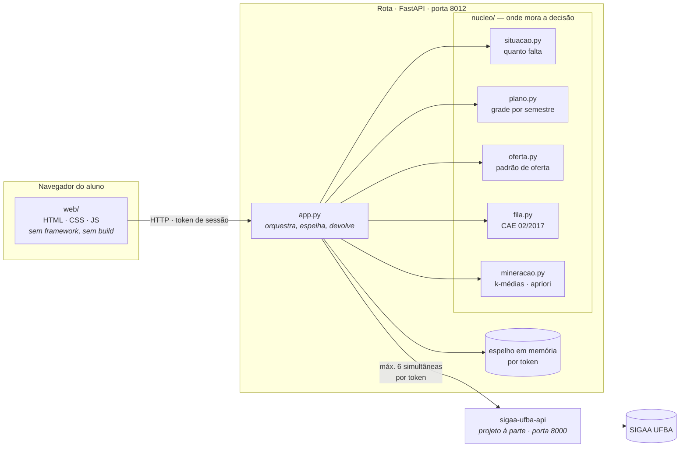
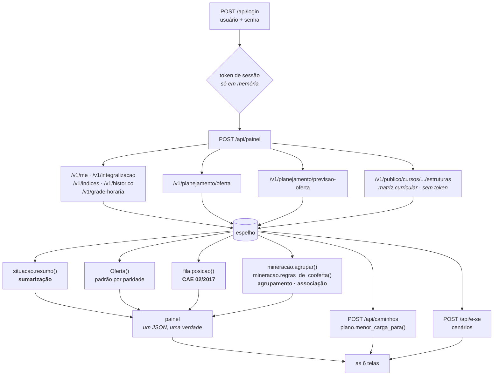
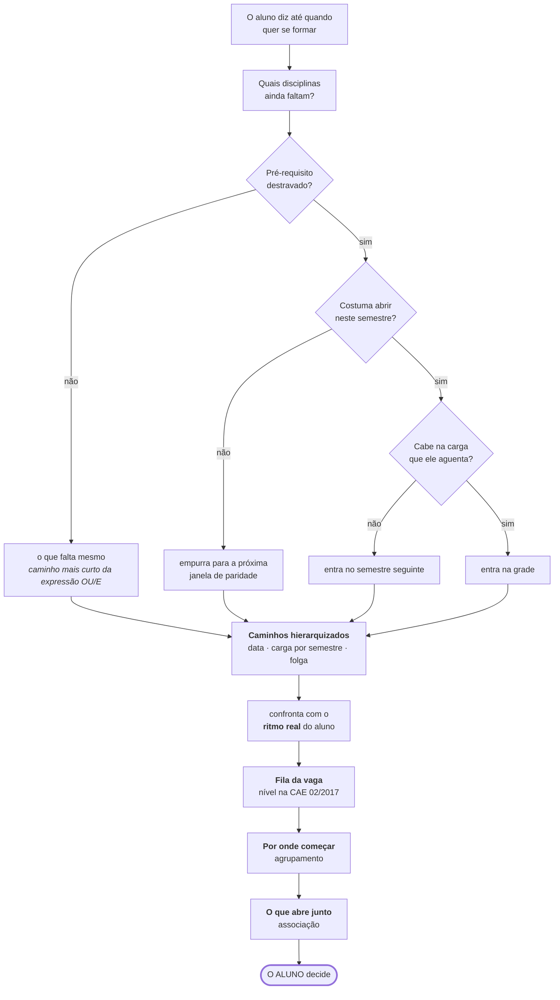

# Arquitetura e fluxo de dados

Três diagramas: **onde as coisas moram**, **por onde o dado passa** e **como a
decisão se forma**. Cada um existe porque responde uma pergunta diferente que
alguém faz ao abrir este repositório.

---

## 1. Arquitetura — onde as coisas moram

**A fronteira entre as camadas é deliberada.**

| camada | regra que ela obedece |
|---|---|
| `web/` | não calcula nada que decida. Se um número aparece na tela, ele veio pronto da API — assim o que o aluno lê e o que o relatório imprime não podem divergir. |
| `app.py` | orquestra e espelha. **Não decide.** Quando precisa de uma regra, chama o `nucleo/`. |
| `nucleo/` | cada módulo responde **uma** pergunta e nenhum sabe que existe uma tela. É o que permite testar a regra sem abrir o navegador. |

**Por que existe o espelho em memória.** A API de origem aceita no máximo **6
requisições simultâneas por token** — medido: 10 rotas frias distintas devolvem
6 × `200` e 4 × `429` em 0,0 s. Sem o espelho, cada ajuste de cenário na tela
refaria a busca inteira e tomaria 429 na cara do aluno. Com ele, a conversa com
a origem acontece **uma vez** e todos os cenários rodam locais. O espelho vive
no processo, por token, e morre com ele — não há banco, não há disco.

---

## 2. Fluxo de dados — do SIGAA à tela

**Três cuidados que o fluxo esconde e que mudaram o resultado:**

1. **A matriz curricular vem de rota pública, sem token** — matriz é documento
   do curso, não dado pessoal. É o que torna o Semestre de Avaliação **exato**
   em vez de estimado por carga horária (o que teria errado o número que
   governa toda a fila).
2. **`faltando` é uma UNIÃO, não uma lista "E".** O SIGAA devolve a união dos
   códigos de todas as alternativas não satisfeitas. Mostrá-la crua fazia a
   tela dizer que Inteligência Artificial exigia 4 disciplinas quando bastava
   uma. `plano.falta_mesmo()` lê a estrutura OU/E e devolve o caminho mais
   curto.
3. **Chance de oferta 0 não quer dizer "não abre".** TCC e estágio nunca abrem
   turma, e tratar o 0 como "não abre" prendia o TCC fora de qualquer plano —
   ou seja, o aluno nunca se formava, silenciosamente.

---

## 3. Fluxo da decisão — como a resposta se forma

O sistema para em `L` de propósito. Ele hierarquiza, mostra a conta e aceita
cenário; não escolhe. A última caixa não é retórica: não existe no código
nenhuma função que devolva "pegue esta disciplina".

---

## O que é projeto à parte

A **`sigaa-ufba-api`** não faz parte deste repositório. Ela é uma API REST
pública e somente leitura para o SIGAA da UFBA, construída para este trabalho,
que faz login com a sessão do próprio aluno e devolve histórico, índices,
integralização, oferta e consultas públicas em JSON.

Repositório: <https://github.com/caioalcarria/sigaa-ufba-api>

A separação importa para a avaliação: o Rota é o **sistema de apoio à decisão**;
a API é a **fonte de dados** que o viabiliza. Misturar os dois num repositório
só esconderia que o SAD depende de uma camada de integração que precisou ser
construída antes — que é, aliás, o ponto de partida do trabalho.
